  

  
  
  
  
  

I am committed to exploring the application of simple and efficient artificial intelligence algorithms in various fields. My research interest comprises:
- AI for Database (e.g., Natural Language to SQL, ChatBI)
- AI for Finance (e.g., Evalution of Financial LLMs, Next-Generation Agentic Finance)
- Reasonable and Efficient Agent System (e.g., Cross-Environment Agentic Reasoning, Latent Space Agent)
- Large Language Models (e.g., Efficient Reinforcement Learning, Diffusion Language Models).

Feel free to contact me if you are interested in these topics. 

